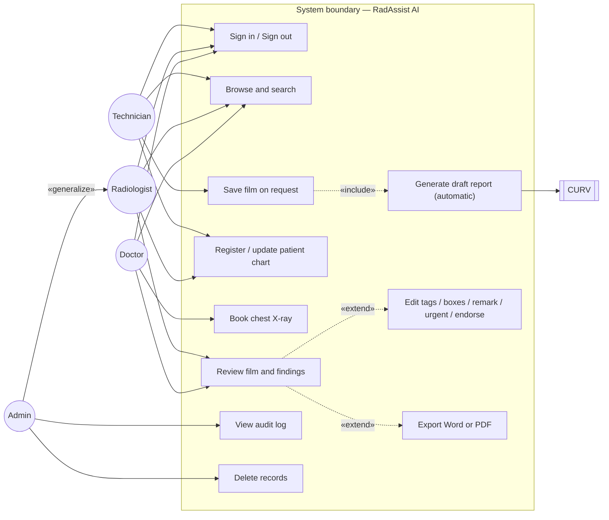
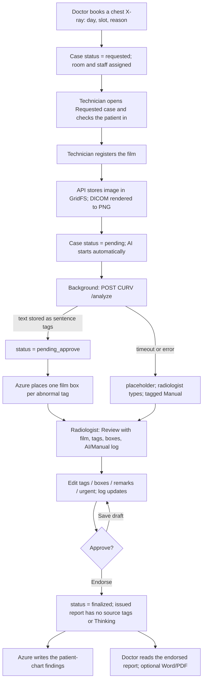
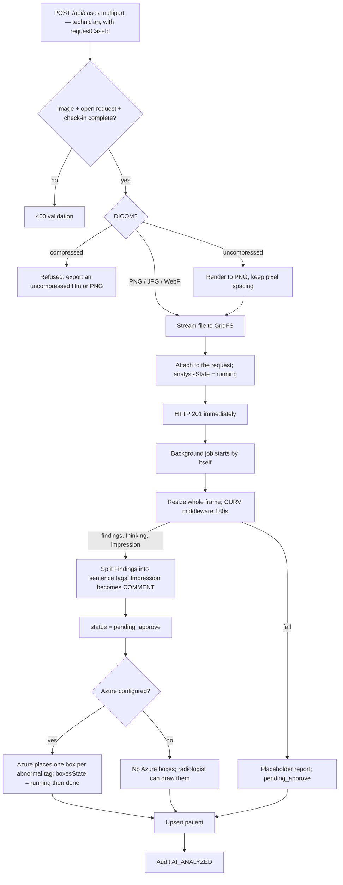
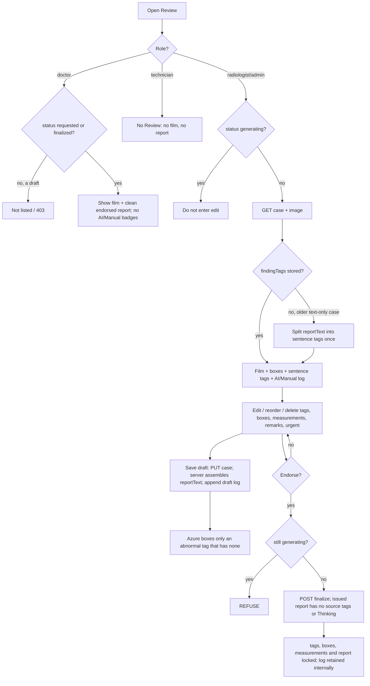
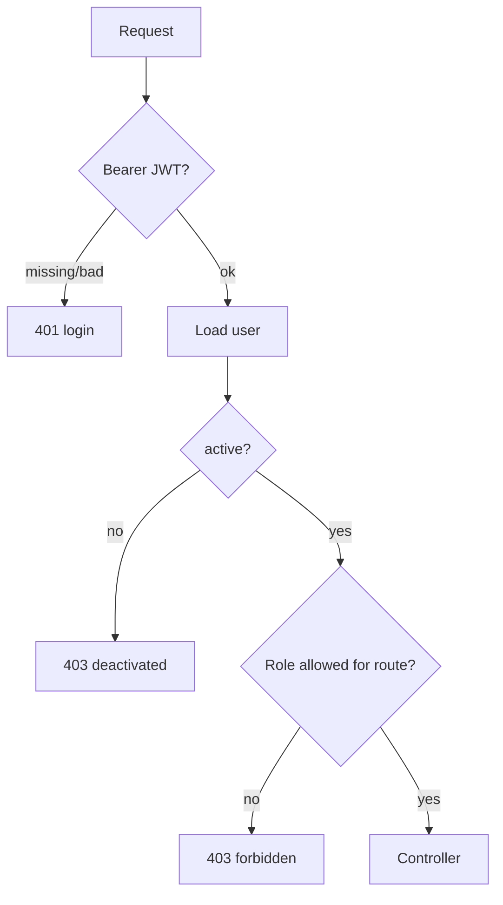
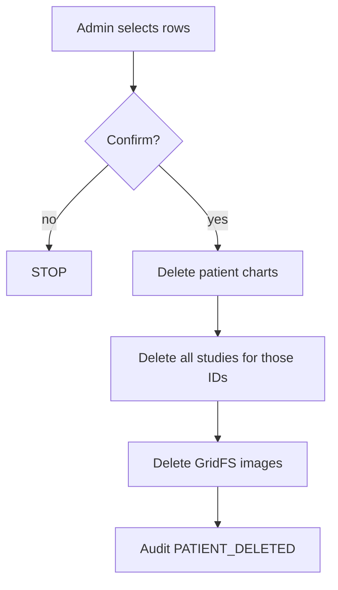
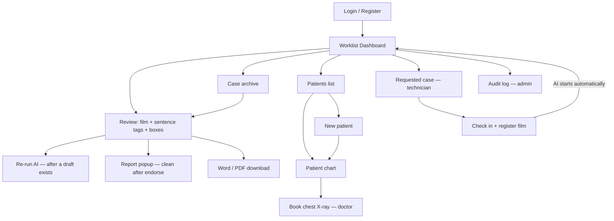

# An AI-assisted Online System for X-Ray Report Generation

**Student:** PANG Ho Yiu (23226609)  
**Working name:** RadAssist AI  
**Document:** Project Plan and Initial System Analysis  
**Source documents:** Project Statement; supervisor briefing slide  
**Type:** Final Year Project (demonstration system, not a clinical product)

> How to use this file: paste into Word, insert the briefing slide as **Figure 1** next to A.1, insert app screenshots in Section B.3, and tick the Department hardware/software list against Section A.2.

> **Status of this document.** Updated to match the built system as described in `README.md`. Four points changed throughout: (1) AI starts **automatically** when the technician saves the film, not from a "Use AI" click; (2) findings are **sentence tags** (editable, reorderable, linked to film boxes), not finding cards; (3) **uncompressed DICOM** is accepted and rendered to PNG with the pixel spacing kept, and **compressed DICOM transfer syntaxes are not supported**; (4) referring doctors see **requested and endorsed** cases, not finalized-only. The word **Finalise** in older sections is the same action as **Endorse** in the app (stored as `status: finalized`). Anything described here that was never built is marked **Not built / Sem 2**.

---

# a. Project Plan

## A.1 Brief Introduction to the Proposed System

This plan follows the approved **Project Statement** (PANG Ho Yiu, 23226609) and the supervisor briefing: *An AI-assisted Online System for X-Ray Report Generation*. The FYP does **not** retrain CURV or AHIVE. It is the **practicum / deployment** piece: wrap those pretrained engines in a complete web information system that a clinical user can use, edit, and export [3].

### A.1.1 Project background

Medical imaging analysis — especially chest X-ray interpretation — sits in many clinical workflows. The next generation of deep learning and vision-language models, both **generative** (**CURV**: Coherent Uncertainty-Aware Reasoning) and **discriminative** (**AHIVE**: Anatomy-aware Hierarchical Vision Encoding), has pushed the state of the art in writing text-based radiology reports from images [1][2].

Even a well-trained diagnostic model still **languishes in scripts and local research environments**. Radiologists also spend a long time writing the same reports by hand. Outside the lab, a machine-learning model is only as useful as it is **realisable on a fast, safe, accessible platform** that healthcare workers can actually open. Bridging that **deployment gap** into a practicum system is the distinctive part of this FYP [3].

The project therefore builds an **end-to-end web information system**: pretrained AI engines behind a solid web interface, turning raw model output into something a **radiologist** can engage with and **export as a document**, while the **referring doctor** only reads reports that have already been signed off.

The briefing slide shows the intended interaction: film on the left, numbered region boxes, grounded findings on the right. This prototype’s review screen is that layout in a browser.

### A.1.2 Problem / improvement areas

The Project Statement names three operational bottlenecks [3]. The briefing slide states the same core problem: preparing an X-ray report is **professional and yet time-consuming**.

| # | Bottleneck (statement) | What “better” looks like |
| --- | --- | --- |
| 1 | **Time-consuming report workflow.** Diagnostic imaging reports are professional work product and occupy valuable hours. | The doctor books the exam, the technician saves the film, and CURV writes the draft **automatically**. The radiologist reviews, edits and endorses instead of typing from a blank page. |
| 2 | **Accessibility of AI utilities.** Research models usually have no standard web UI; they stay with the “digital magician,” out of reach of the practitioner. | Browser login and worklist — no Python notebook, no command line. Nobody types a prompt: AI starts by itself when the film is saved, and the radiologist can re-run it after a draft exists. |
| 3 | **Batch / static I/O.** Image-in, text-out systems are not interactive. Radiologists need to **see the region the model used** and **edit the text**, with a clear record of what was AI vs what they typed. | Side-by-side film + report. The report is a list of editable **sentence tags**; each abnormal tag has one **film box** placed by Azure. An **AI / manual attribution log while drafting**; the **endorsed report is clean** (no source tags, no Thinking). Word/PDF export of that final text. |

This FYP is an **information-systems** project (workflow, UI, API, documents), not a new accuracy benchmark for CURV.

### A.1.3 Objectives

1. Develop an **online prototype** that uses a pretrained AI model (**CURV**) to **assist** radiologists by generating X-ray reports (briefing + statement).
2. Provide an **interactive, user-friendly interface** that speeds up report preparation: doctor booking, technician saves the film, automatic AI draft, sentence tags with film boxes, endorse, export (briefing).
3. Wrap the model in a **complete web information system** (sessions, async inference, persistence, document generation) so it is usable outside a research script [3].
4. Keep the **radiologist in the loop**: AI output is a draft until a radiologist (or admin acting as radiologist) endorses it. Referring **doctors** see **requested and endorsed** cases only, never drafts, and cannot edit a report. **Technicians** save the film for a booked request and never see the report.
5. Run **locally in Semester 1** (supervisor). Optional 24/7 server in **Semester 2**.

### A.1.4 Proposed system

Working name: **RadAssist AI**. Role-separated, clinician-in-the-loop web application:

1. Authorised staff sign in as **technician**, **radiologist**, **doctor**, or **system administrator**.
2. Patient chart (name, age, sex, history, **prior medicines**, **heart rate**, **lab test results**) before or at imaging.
3. **Technician** opens **Requested case** and saves the chest X-ray for a booked request. At check-in the technician confirms the patient identity, patient number, examination request, body part and appointment before the film can be saved. Formats: **PNG / JPG / JPEG / WebP** and **uncompressed DICOM**. A `.dcm` film is rendered to a PNG with the pixel spacing kept, so **Measure** can report centimetres. **Compressed DICOM transfer syntaxes are not supported**: the file must be exported as an uncompressed film or a PNG. Saving the film stores it and starts AI at once.
4. **Referring doctor** books a chest X-ray on a calendar (day, 30-minute slot, quota, clinical reason, urgency); the booking assigns a room, equipment, radiographer and preparation note. Once the **technician** saves the film, inference starts **automatically** — there is no Use AI click. The backend sends the film with the **official CURV conversation** from the model release: the system prompt in `prompt_cxr.txt` and the user line “Please analyze this chest X-ray image…”. CURV replies with `<findings>`, `<thinking>`, and `<impression>`. The radiologist opens the work list, sees the case as **Generating** and then **Pending approve**, edits it and endorses it [1][3].
5. Frontend renders the film beside the report. The report is a list of **sentence tags**: one per finding sentence, each editable, reorderable by drag, deletable and switchable between normal and abnormal. CURV writes the text only; **Azure OpenAI places the film boxes**, one per abnormal tag, linked to its tag. While the radiologist edits, the review screen shows an **attribution log** (which sentences are **AI** vs **manual**). Remarks, urgency, measurements, explicit **endorsement** (finalisation).
6. On endorse, the **issued report is the clean clinical text** — AI/manual markers and the model’s Thinking stay in the system audit / draft log and are **not** printed in the report the doctor sees or exports.
7. **Doctor** sees **requested and endorsed** cases (read-only), never drafts. They do not save films, run AI, or edit a report. They can book exams and order labs.
8. **System administrator** keeps the usual platform functions (all radiologist capabilities plus bulk delete, user/audit administration).
9. Audit log; **PDF / DOCX** export of the **verified, unmarked** report [3].

Decision-support prototype only — not a PACS, not a medical device, not a substitute for a radiologist. If CURV is down, the case is still stored so the radiologist can write the report by hand.

**Out of scope unless Sem 2 time allows:** retraining CURV/AHIVE; full DICOM/PACS; hospital SSO; extra identifiers (e.g. HKID); CE/FDA claims; unattended auto-sign-off.

### A.1.4a Out of scope in Semester 1

- **Full DICOM / PACS** (a PACS viewer, a DICOM store and compressed transfer syntaxes) is out of scope for Sem 1 because the semester's time goes to the booking-to-endorse workflow and its tests, and a cohort of about 350 MIMIC patients with one film each is served by uncompressed DICOM rendered to PNG.
- **AHIVE** is out of scope for Sem 1 because the plan wraps the pretrained CURV and does not retrain CURV or AHIVE, so no retrieval model is trained, integrated or evaluated this semester.

### A.1.5 Development methodology (from the Project Statement)

Four phases [3]. Success is measured as an **information system** (API behaviour, pipeline latency, browser UI), not only model accuracy.

| Phase | Statement plan | How this prototype implements it |
| --- | --- | --- |
| **1. Requirements & workflow** | Upload → async process → report + bboxes → render with overlays. | Doctor **books** the exam; technician **saves the film** on that request; CURV starts **automatically**. Express returns immediately while CURV runs; the work list shows **Generating** then **Pending approve**. After the draft is stored, Azure places the film boxes; Review shows film + tags + boxes. |
| **2. Frontend & interaction** | SPA; **bilateral binding** (text ↔ region); **confidence threshold** slider; **interactive sentence / chip** editing. | Vanilla JS SPA (Vite + Tailwind). Statement mentioned React/Vue as examples; a lightweight SPA meets the same interaction goals. **Built:** sentence tags with inline edit, drag to reorder and a normal/abnormal switch; clicking a tag selects its film box and clicking a box selects its tag; hovering a tag lights up its film box and hovering a box lights up its tag; a **Min confidence** slider on Review hides film boxes below the chosen confidence without reloading (0% shows all; view only, nothing is saved); **AI vs manual log on Review while drafting**. |
| **3. Backend API gateway** | Node.js routes, sessions, queue; **document engine** (PDF/DOCX) after the user verifies edits. | Express + JWT; background AI job started **when the film is saved**; `docx` / PDF download — **export is the clean report**, not the draft attribution log. Cosmos DB + GridFS persist patients, cases, images. |
| **4. Verification & (later) deploy** | Black-box API tests; upload-to-UI latency; browser compatibility. | Frontend unit tests + case e2e script. Sem 1: local demo. Sem 2: optional 24/7 host, more API tests, multi-browser check. |

---

## A.2 Resource Implications

*[Please replace the “Dept list” column after you open the Department’s official hardware and software list. Items not on that list may be unavailable and must be provided by the student or by a free/student cloud tier.]*

### A.2.1 Hardware

| Item | Purpose | Likely on Dept list? | Plan if unavailable |
| --- | --- | --- | --- |
| Student Apple Silicon Mac (already owned) | Run CURV / `mlx_vlm` locally; host the demo | Unlikely (Dept labs are usually Windows PCs) | Use personal Mac for AI inference. This is the critical resource. |
| Dept Windows PC / laptop | Coding, Word, browser testing | Usually yes | Use for documentation and secondary UI testing. Do **not** rely on it for CURV. |
| 16 GB+ RAM, SSD | Model weights + Node + browser | Check list | Personal Mac already meets this. |
| GPU / CUDA workstation | Alternative inference host | Sometimes a shared lab GPU | Not required while `mlx_vlm` runs on Apple Silicon. Sem 2 deploy would need a dedicated box. |
| Display ≥ 1920×1080 | Review screen (film + sentence tags) | Yes | Any lab monitor is enough for the viva. |
| Network (campus Wi-Fi / Ethernet) | Cosmos DB and optional Azure OpenAI | Yes | Local CURV still works if cloud is down; cases save with a placeholder report. |

**Implication:** the vision model is tied to the student’s Mac. A Department PC alone cannot currently replace it. That matches the supervisor’s “run on your local machine first” instruction.

### A.2.2 Software

| Item | Role | Licence | Likely on Dept list? |
| --- | --- | --- | --- |
| Node.js 20+, npm | Backend (Express) and frontend (Vite) | Open source | Often yes, or installable by student |
| Python 3.12, `mlx_vlm` | Local CURV server | Open source | **Unlikely** — student-installed on Mac |
| CURV model weights (`~/CURV-mlx`) | Chest X-ray report generation | Research weights already downloaded | Not a Dept item |
| Visual Studio Code / Cursor | Development | Free | Usually yes |
| Git | Version control | Open source | Yes |
| Chrome / Edge / Safari | Client | Free | Yes |
| Microsoft Word / PowerPoint | Report and viva | Campus licence | Yes |
| Express 4, Mongoose 8, JWT, Helmet | REST API, auth, security headers | Open source (npm) | N/A (student stack) |
| Vite 8, Tailwind CSS 3 | UI | Open source | N/A |
| FastAPI / Uvicorn | Thin middleware in front of `mlx_vlm` | Open source | N/A |
| Azure Cosmos DB (Mongo API) | Patients, cases, users, audit, GridFS images | Azure student / pay-as-you-go | Check whether Dept offers Azure credits |
| Azure OpenAI (optional) | Film boxes (one per abnormal tag), patient-chart findings after endorse, short work-list label after a manual edit | Azure | Optional; system runs without it (no Azure boxes, only the ones the radiologist draws) |
| PlantUML / draw.io / Mermaid | UML for this document | Free | Yes |

**Implication:** all application code is free/open source. The only paid or quota-limited services are Azure Cosmos DB and, if enabled, Azure OpenAI. Neither is required on the Department software CD/image; they are cloud services.

### A.2.3 Data and ethics (resource, not hardware)

Demo patients and films only. No real hospital export. No HKID, address, or other extra identifiers. Seed accounts are for local demo only; their passwords are set in `backend/.env` (`SEED_*_PASSWORD`, see `backend/.env.example`), not in the code. Chart fields such as prior medicines, heart rate, and lab results are **synthetic demo data**, not real clinical records.

---

## A.3 Development and Operating Costs

Figures are **order-of-magnitude estimates in HKD** for a student demonstration, not a hospital procurement. Labour is the student’s own FYP time and is shown only to make the cost–benefit discussion honest.

### A.3.1 Development costs (one-off, Sem 1–2)

| Cost item | Estimate | Notes |
| --- | --- | --- |
| Student development time (~400–500 hours FYP) | HKD 0 cash (opportunity cost only) | Design, code, test, report, viva |
| Personal Mac already owned | HKD 0 incremental | Would be ~HKD 8,000–15,000 if purchased only for this project |
| CURV weights + `mlx_vlm` | HKD 0 | Already downloaded; research use |
| Open-source stack | HKD 0 | Node, Python, Vite, Express |
| Azure Cosmos DB during development | ~HKD 0–150 / semester | Serverless / student subscription; low document volume |
| Azure OpenAI during development (optional) | ~HKD 0–200 / semester | Only if Azure film boxes and chart findings are turned on |
| Domain / 24/7 VM (Sem 2, optional) | HKD 0 in Sem 1; ~HKD 200–600 / semester later | Supervisor: deploy in Sem 2 |
| **Cash outlay Sem 1** | **≈ HKD 0–350** | Dominated by Azure if used |

### A.3.2 Operating costs (if the demo is kept running)

| Cost item | Local laptop demo | Sem 2 24/7 server (optional) |
| --- | --- | --- |
| Electricity (Mac + screen) | Negligible / personal | VM billed by cloud |
| Database | Cosmos: a few dollars/month at demo scale | Same |
| AI inference | Local Mac: HKD 0 API fees | GPU/Apple box must stay on; electricity + maybe cloud GPU |
| Azure OpenAI | Off = HKD 0; On = usage-based | Same |
| Maintenance | Student restarts three processes | Process manager + backups |
| **Recommended operating mode for FYP** | **Laptop demo for viva** | Only if supervisor requests a public URL |

There is **no licence fee** for the application itself. The expensive part of a real hospital system (PACS, HL7, 24/7 SLA, clinical validation) is deliberately out of scope, so operating cost stays in the student-cloud range.

---

## A.4 Tangible and Intangible Benefits

### A.4.1 Tangible (observable, even in a demo)

| Benefit | Who | How the prototype shows it |
| --- | --- | --- |
| Capture without reporting | Technician | Saves the film on a booked request; no report, no edit, no endorse. The film and report are hidden from technician responses |
| Faster first draft | Radiologist | Technician saves the film → CURV starts **automatically** → worklist row moves from *Generating* to *Pending approve* |
| Structured findings, not only a wall of text | Radiologist | One **sentence tag** per finding; each abnormal tag has one film box placed by Azure, which the radiologist can move, resize or remove |
| Draft provenance | Radiologist | Review log marks each sentence **AI** or **Manual** while editing |
| Clean signed report | Doctor / export | After endorse, the report the doctor sees (and Word/PDF) has **no** AI/manual tags and no Thinking |
| Human sign-off is mandatory | Patient safety (demo) | Status cannot skip to *Finalized* while the draft is still generating; technician and doctor cannot endorse |
| Role separation | Clinic | Technician: save the film for a booked request. Radiologist: edit + endorse (AI starts on its own). Doctor: books exams, orders labs, reads requested and endorsed cases. Admin: platform + delete |
| Searchable worklist | Per role | Filter by status / urgent; live search; urgent rows sort first. Doctor list = requested and endorsed cases |
| Export | Radiologist (and doctor of an endorsed case) | Word and PDF of the stored **clean** report, plain or with a finding film per abnormal tag |
| Traceability | Admin / supervisor | Audit log of login, film registration, AI analyse, update, endorse, delete; draft AI/manual log retained in the case history even after the issued report is clean |
| Patient chart independent of a film | Technician / radiologist | Patient can exist with zero studies; chart shows **medicines**, **heart rate**, **lab tests**; the film is saved against an open request for that patient |
| Degraded operation | Ops | If CURV is down, the film is still saved; radiologist can type the report |

### A.4.2 Intangible

- Reinforces **radiologist-in-the-loop** as a design principle (doctor requests; technician captures; AI drafts; radiologist decides; doctor consumes the endorsed report).
- Gives referring doctors a way to **see** endorsed reports and patient context without being able to alter imaging interpretation.
- Student learning: full-stack web system, JWT roles, GridFS, local VLM, optional cloud NLP.
- Reusable demo for the viva: one laptop, three processes, seeded users (technician / radiologist / doctor / admin).
- Clear story for Semester 2 (hardening, CORS, cookies, possible deploy) without blocking Semester 1.

---

## A.5 Cost–Benefits Analysis

This is not a commercial product, so a classic NPV is not meaningful. The comparison is **student cash + time versus FYP learning outcomes and demo quality**.

| Option | Cash (Sem 1) | Time | Benefit | Risk |
| --- | --- | --- | --- | --- |
| **A. Do nothing / report-only FYP** | HKD 0 | Low | Weak viva | Fails “working system” expectation |
| **B. Script: image in, text out (old demo)** | HKD 0 | Low–medium | Proves CURV works | No workflow, no roles, no persistence |
| **C. Proposed local web system (recommended)** | HKD 0–350 | High | Full use-case demo, audit, HITL, role split | Tied to student’s Mac for AI |
| **D. Full 24/7 hospital-like deploy now** | Higher VM/GPU | High + ops | Public URL | Supervisor deferred this to Sem 2; over-scope |

**Conclusion:** Option C dominates. Incremental cloud cost is small compared with the jump from a one-page CURV tester to a role-based reporting workflow. Option D’s extra cost does not buy extra FYP marks in Semester 1 and conflicts with supervisor guidance. Intangible benefit of C (safety workflow, audit, technician / radiologist / doctor split) is exactly what a project titled *“AI-assisted Online System”* should show: **assisted**, not autonomous; **online** (browser + API), not a notebook.

Break-even in money terms is immediate: almost all spend is already-owned hardware and free software. The scarce resource is student hours, which are required by the FYP anyway.

---

## A.6 Development Schedule

Supervisor constraint: **local machine in Semester 1; server deployment may wait until Semester 2.**  
Academic year assumed: 2026/27. Adjust week numbers to the Department calendar.

The Gantt implements the four statement phases: WP1 = Phase 1 (requirements); WP2–4 = Phase 3 (gateway + async AI); WP5–6 = Phase 2 (interactive UI + export); WP8 + WP11 = Phase 4 (verification); WP10 = Phase 4 deploy.

### A.6.1 Gantt-style plan

| ID | Work package | Sem 1 Wks 1–4 (Sep) | Wks 5–8 (Oct) | Wks 9–12 (Nov) | Wks 13–14 (Dec) | Sem 2 Jan–Feb | Mar–Apr | May |
| --- | --- | --- | --- | --- | --- | --- | --- | --- |
| WP1 | Requirements, this plan, use cases, UI storyboards | **██** | ░ | | | review | | |
| WP2 | Local CURV + FastAPI middleware | **██** | █ | | | | | |
| WP3 | Express API, Cosmos, JWT roles, GridFS | █ | **███** | █ | | | | |
| WP4 | Patients, doctor booking, technician saves the film, automatic CURV draft | | **██** | █ | | | | |
| WP5 | Review UI: film, boxes, sentence tags, AI/manual log, remarks, urgent, endorse | | █ | **███** | █ | polish | | |
| WP6 | Worklist (role-filtered), archive, audit, Word/PDF, doctor read-only (requested and endorsed) | | | **██** | █ | | | |
| WP7 | Optional Azure film boxes, patient-chart findings, work-list label | | | █ | █ | eval | | |
| WP8 | Tests, seed data, bug-fix, viva script | | | █ | **██** | █ | | |
| WP9 | FYP report chapters (analysis, design, implementation) | █ | █ | █ | **██** | **██** | **██** | |
| WP10 | Sem 2: hardening + optional 24/7 deploy | | | | | █ | **██** | |
| WP11 | Evaluation, limitations, viva | | | | demo | | █ | **██** |

█ = planned intensive work. The implementation WPs 2–6 are **already substantially built** in the current prototype; the four roles (technician / radiologist / doctor / admin), the Review attribution log, and the patient chart vitals/labs/meds are built. Remaining Sem 1 effort is documentation, tests, evaluation, and polish. The hover-both-ways highlighting and the confidence slider from the statement are built on the Review page.

### A.6.2 Milestones

| Milestone | Target | Exit criteria |
| --- | --- | --- |
| M1 Local CURV path | Early Sem 1 | A saved film starts CURV automatically → report returned |
| M2 HITL web workflow | Mid Sem 1 | Doctor books; technician saves the film; CURV drafts; radiologist reviews and endorses; doctor sees only requested and endorsed cases; technician cannot edit |
| M3 Supervisor checkpoint | When this document is submitted | Confirm scope: local demo OK; deploy Sem 2 |
| M4 Sem 1 demo freeze | End of Sem 1 | Seeded users (four roles), three processes start script, no blocker bugs |
| M5 Optional deploy | Sem 2 | Reverse proxy + secrets; CURV still on a dedicated host |
| M6 Viva | Sem 2 | 10-minute live walkthrough (see README demo script) |

### A.6.3 Dependencies and slack

- WP5 depends on WP3–4 (case must exist with `imageId`; the automatic draft may still be generating).
- WP7 is optional; WP5 splits the CURV text into sentence tags locally, so with Azure off the report still works and only the boxes the radiologist draws appear.
- WP10 must not start until M3 (supervisor) agrees.
- Critical path is **Mac + CURV remaining available** for any live demo.

---

## A.7 System Recommendation

**Recommend proceeding with the proposed system (Option C)** as the FYP implementation vehicle.

### A.7.1 Recommended architecture (summary)

```
Browser (Vite, localhost:5173)
        → Express API (localhost:5002, JWT + roles)
              → Azure Cosmos DB (Mongo API) + GridFS
              → FastAPI middleware (localhost:8001)
                    → mlx_vlm CURV (localhost:8080)
              → Azure OpenAI (optional)
```

- **Presentation:** vanilla JS SPA + Tailwind (Vite). The Project Statement named React/Vue as example frameworks; the SPA behaviour (film, boxes, sentence tags, export) is what matters.
- **Application:** REST, role middleware, audit writer.
- **Data:** Patient (incl. medicines, heart rate, lab results), Case (`findingTags`, film boxes in `findings`, report, status, urgent, **draft attribution log**), User, AuditLog, images in GridFS.
- **AI:** local CURV writes the report text only, called with the official system prompt and user line from the CURV release (not a prompt typed by the radiologist, and not an image-only call). It starts **automatically** when the film is saved; there is no Use AI click, and a radiologist can re-run it once a draft exists. CURV does not draw boxes. Optional Azure places one film box per abnormal tag, writes the patient-chart findings after endorse, and refreshes the work-list label after a manual edit. Azure never writes the report text.
- **Control principle:** AI never endorses. Status is `requested` (booked, no film) → `pending` (film stored, AI generating) → `pending_approve` → `finalized`. Issued report text is unmarked.

### A.7.2 Why this, not the alternatives

| Alternative | Why not (for this FYP) |
| --- | --- |
| Standalone CURV webpage only | No patients, roles, audit, or sign-off — does not match “online system” |
| Fully automatic reports | Clinically unacceptable; contradicts HITL |
| AI waits for a radiologist click (the earlier design of this plan) | Replaced. AI now starts when the film is saved, which saves a click; the output is still only a draft that stays with the radiologist until endorsed, and the technician never sees it |
| Cloud-only vision API, no local CURV | Loses the model already running on the Mac; ongoing token cost; weaker “we run the model” story |
| Native desktop app | Harder to show “online”; worse for Sem 2 deploy |
| Full PACS / DICOM in Sem 1 | Uncompressed DICOM is accepted and rendered to PNG with the pixel spacing kept. Compressed transfer syntaxes and a PACS viewer are **Not built / Sem 2** (see A.1.4a, Out of scope in Semester 1). |

### A.7.3 Conditions of recommendation

1. Keep the **human-in-the-loop** rule in every demo and in the report: radiologist signs; doctor reads requested and endorsed cases only, never drafts.
2. Stay on **localhost for Sem 1**, as advised.
3. Treat Azure OpenAI as **optional enhancement**, not a single point of failure.
4. Do not collect extra personal identifiers.
5. Label every AI output as draft / decision support **on the Review screen**; the **finalized report** presented to the doctor is unmarked clinical text.
6. Sem 2 deploy only after secret handling and token storage are reviewed. Done locally: CORS allow-list (`ALLOWED_ORIGINS`), admin-only register, demo passwords from `backend/.env`. Still open: the login page's one-click demo buttons carry fixed demo passwords, and the JWT is kept in `localStorage`.

**Recommendation statement:** *The Department is requested to approve this project plan and the initial analysis below. The student will continue development on a local machine and will not require non-list hardware from the Department beyond standard lab PCs for documentation. The Apple Silicon Mac and CURV weights are student-provided.*

---

# b. Initial System Analysis

## B.1 Initial Use Case Model

### B.1.1 Actors

| Actor | Type | Description |
| --- | --- | --- |
| Technician | Primary | Signs in, browses Patient Master and edits the patient chart, opens **Requested case**, checks the patient in and **saves the film** on a booked request. No report, no edit, no endorse; the film and report are not returned to a technician |
| Radiologist | Primary | Opens the work list, reviews the automatic draft, edits sentence tags, boxes and measurements, marks urgent, endorses, shares and exports; can re-run AI once a draft exists. **Replaces the former “doctor” reporting function** |
| Doctor | Primary | Referring clinician: **books chest X-rays**, orders labs, and reads **requested and endorsed** cases in Examination enquiry; read-only film + clean report + patient chart (meds, heart rate, labs). Cannot save a film, run AI, or edit a report |
| System administrator | Primary | All radiologist functions plus bulk delete of cases, patients, and audit rows; user administration; the audit log |
| CURV (local VLM) | Supporting | Returns `<findings>`, `<thinking>` and `<impression>` text when the film is saved (or a radiologist re-runs AI). It does not draw boxes |
| Azure OpenAI | Supporting (optional) | Places one film box per abnormal sentence tag; writes patient-chart findings after endorse; refreshes the work-list label after a manual edit. Never writes the report |
| Cosmos DB | Supporting | Persists users, patients, cases, audit, images |

Guest / anonymous users have only Login. `POST /api/auth/register` now needs an administrator's token, so there is no public self-signup (the Register page on the login screen tells a visitor to ask an administrator).

The previous nurse / “doctor does everything” split is **superseded**. Capture (technician), interpretation (radiologist), and consumption of signed reports (doctor) are three different jobs.

### B.1.2 Use case diagram

Actors are specialised by **job**, not by a linear generalisation of “nurse ⊂ doctor ⊂ admin”. Technician, radiologist, and doctor share sign-in and (role-filtered) browse. Supporting system **CURV** is on the right. Details of UC06–UC08 stay in the descriptions; on the diagram they sit under «extend» from Review.



Same diagram as a Word-friendly sketch (paste into draw.io or redraw in PowerPoint):

```
 Admin ──«generalize»──► Radiologist
    │                         ├── Sign in / Sign out
    │                         ├── Browse and search
    │                         ├── Review film ──«extend»──► Edit tags / boxes / remark / urgent / endorse
    │                         │               └──«extend»──► Export Word / PDF
    │                         └── Register / update patient chart
    ├── View audit log
    └── Delete records

 Technician ── Sign in / Browse / Patient chart / Save film on request ──«include»──► Generate draft (automatic) ──► CURV
 Doctor     ── Sign in / Browse requested + endorsed / Book chest X-ray / Review read-only (clean report)
```

**Include / extend:** Saving the film **includes** Generate draft: CURV starts on its own, with no click. Edit, remarks, urgent, endorse, and export extend Review. Optional Azure boxes follow the stored draft when Azure is configured (not shown, to keep the figure small). **Re-run AI** is also built (a radiologist or admin, once a draft exists) and is not drawn.  
**Who can do what:** see the role matrix in B.1.4.

### B.1.3 Use case descriptions

#### UC01 Sign in

| Field | Content |
| --- | --- |
| ID | UC01 |
| Actors | Technician, Radiologist, Doctor, Admin |
| Goal | Obtain a session so role-based screens are shown |
| Precondition | Account exists and is active |
| Main success | 1. User opens the app. 2. Enters username/email and password. 3. System verifies password, issues JWT, writes LOGIN audit. 4. User lands on the worklist appropriate to their role. |
| Alternatives | Invalid credentials → error, stay on login. Deactivated account → forbidden. |
| Postcondition | `user` + token in session; sidebar matches role (technician: Requested case; doctor: Patient Master, booking and Examination enquiry, no drafts; radiologist: X-ray Worklist and Review; admin: full, including Users and Audit). |

#### UC02 Register / update patient chart

| Field | Content |
| --- | --- |
| ID | UC02 |
| Actors | Technician, Radiologist, Admin |
| Goal | Create or update a chart before / around imaging |
| Precondition | Signed in as technician, radiologist, or admin |
| Main success | 1. Open New patient or existing chart. 2. Enter first name, last name, age, sex (middle name and ID optional). 3. Record **prior medicines**, **heart rate**, and **lab test results** (demo fields). 4. Empty ID → system assigns `PT-{year}-{nnnn}`. 5. Patient stored; studies optional. 6. Chart opens. |
| Alternatives | Duplicate / already found in type-ahead → open existing chart. Doctor → cannot edit the chart; can order labs, and sees requested and endorsed studies. |
| Postcondition | Patient document exists; PATIENT_CREATED / PATIENT_UPDATED audit. |

#### UC03 Book a chest X-ray and save the film

| Field | Content |
| --- | --- |
| ID | UC03 |
| Actors | Referring doctor or Admin (book); Technician or Admin (save the film) |
| Goal | A doctor requests a chest X-ray for a patient and a technician attaches the film to that request, so a radiologist can report. |
| Precondition | Patient exists. Booking: signed in as doctor or admin. Saving the film: signed in as technician or admin, the request is open, the check-in is complete, and the file is PNG/JPG/JPEG/WebP or **uncompressed DICOM** |
| Main success | 1. Doctor opens the patient chart, **Book chest X-ray**, picks a day and a free 30-minute slot within the quota, gives the clinical reason and urgency. 2. Case saved as `requested` with `scheduledAt` and no film; the booking assigns a room, equipment, radiographer and preparation note. 3. Technician opens **Requested case**, checks the patient in (identity, patient number, request, body part, appointment) and chooses **Register film**. 4. Image stored in GridFS (a `.dcm` film is first rendered to PNG with its pixel spacing kept). 5. Case becomes `pending` and **UC04 starts automatically**. 6. Technician returns to **Requested case**. |
| Alternatives | A second open request for the same patient → refused. Full slot or day → booking refused. Missing file → validation toast. Compressed DICOM → refused with a message asking for an uncompressed film or a PNG. Radiologist → cannot book or save films. |
| Postcondition | Case has `imageId`; CASE_CREATED audit. The technician never sees the film or report afterwards. |

#### UC04 Generate draft report (automatic)

| Field | Content |
| --- | --- |
| ID | UC04 |
| Actors | CURV (supporting); started by the system when the film is saved. A Radiologist / Admin can **Re-run AI** from Review once a draft exists |
| Goal | Produce the draft report text without blocking the UI. There is no Use AI click and no prompt box |
| Precondition | Case stored with an image; AI middleware reachable *or* failure handled |
| Main success | 1. Film saved; API returns at once with `analysisState: running`. 2. Backend resizes the whole frame to the CURV pixel budget and POSTs it to `/analyze` (timeout ~180s). Middleware sends the official CURV system prompt, the user line, and the film. Age, sex, history, and medicines stay on the chart. 3. Map the reply (`Findings`, `Thinking`, `Impression`) onto the case. The Findings are split into **sentence tags** (one per sentence, normal or abnormal by rule), the Impression becomes COMMENT, and Thinking is stored but never shown. 4. Status → `pending_approve`. 5. If Azure is configured, it places one film box per abnormal tag (`boxesState: running` → `done`/`failed`); it never edits the report. 6. Upsert patient from case. 7. AI_ANALYZED audit. |
| Alternatives | CURV down/timeout → placeholder text “[AI analysis unavailable …]”, still `pending_approve`, and the radiologist completes the report by hand (`source: manual`). Azure off or failing → no Azure boxes; the radiologist can draw them. Technician / doctor → cannot re-run AI. |
| Postcondition | Radiologist can continue Review. The work-list **Generating** state clears when status is no longer generating. |

#### UC05 Review film and findings

| Field | Content |
| --- | --- |
| ID | UC05 |
| Actors | Radiologist, Admin (edit); Doctor (read-only, **requested and endorsed cases only**); Technician (sees the request, not the film or the report) |
| Goal | See the film, its boxes, and the report as sentence tags together; for the radiologist, also see **AI vs manual** attribution while drafting |
| Precondition | User authenticated. Doctor: case must be `requested` or `finalized`, and a generating draft stays closed. Radiologist: case not still generating (or generating overlay). |
| Main success | 1. Open Review from the worklist. 2. Load case and image. 3. The report shows as a list of **sentence tags** (an older report that is only text is split once). 4. Each abnormal tag has one film box, selected from the tag or from the box. 5. **Draft state:** the page shows an attribution log of **AI** vs **manual** edits. 6. **Endorsed state (doctor and export):** report body is **clean** — no source tags and no Thinking. |
| Alternatives | Still generating → Review blocked for editing. Doctor on a draft → hidden / forbidden. Technician → no Review at all. |
| Postcondition | Radiologist understands the draft and may continue to UC06–UC10. Doctor understands the endorsed report. |

#### UC06 Edit sentence tags, boxes and measurements

| Field | Content |
| --- | --- |
| ID | UC06 |
| Actors | Radiologist, Admin |
| Goal | Correct the AI draft or add a finding the model missed, with a visible draft log |
| Precondition | UC05; case not endorsed |
| Main success | Edit a tag’s words, **delete** it, switch it **normal / abnormal**, or drag it to a new place; type a new finding at the end. Draw, move, resize or remove a film box; use **Measure** or **Heart size** to write a measurement into a sentence. **Save draft** stores the tags and the assembled report; Azure places a box only for an abnormal tag that has none. The Review **attribution log** records the added, removed and edited lines, boxes and measurements, with actor and time. |
| Alternatives | Endorsed → tags, boxes and measurements are locked; the log is not shown on the issued report (retained in audit / case history). Doctor / technician → no. |
| Postcondition | `findingTags[]`, the film boxes in `findings[]`, `measurements[]` and the draft log are updated; CASE_UPDATED audit. Issued report text, once endorsed, does **not** contain the log. |

#### UC07 Save remarks

| Field | Content |
| --- | --- |
| ID | UC07 |
| Actors | Radiologist, Admin |
| Goal | Add follow-up notes that do not rewrite a locked report body after sign-off |
| Precondition | Case exists |
| Main success | Type remarks; save (allowed **after** finalise). Chart remarks on the patient are separate and are **not** copied into the case report. |
| Postcondition | `remarks` stored. |

#### UC08 Mark or clear urgent

| Field | Content |
| --- | --- |
| ID | UC08 |
| Actors | Radiologist, Admin (a doctor can **see** the tag on a requested or endorsed case) |
| Goal | Triage flag (not a legal priority) |
| Precondition | Case exists |
| Main success | Toggle urgent; worklist and patient list show the chip; urgent rows sort first. Allowed after finalise. |
| Postcondition | `urgent` boolean updated. |

#### UC09 Endorse (finalise) report

| Field | Content |
| --- | --- |
| ID | UC09 |
| Actors | Radiologist, Admin |
| Goal | Sign off: diagnosis, report text, tags, boxes and measurements become immutable **clinical text without AI/manual labels** |
| Precondition | Status is `pending_approve` (not still generating) |
| Main success | Choose **Endorse report**; the issued `reportText` is the clean text from the tags and COMMENT, with no Thinking section; `finalizedBy` and `finalizedAt` recorded; CASE_FINALIZED audit. Draft attribution remains in an internal log / audit, not in the doctor-facing report. Azure then writes the patient-chart **Findings** from the clean report in the background. |
| Alternatives | Still generating → refused. Technician / doctor → forbidden. |
| Postcondition | Status `finalized`; remarks and urgent still editable by radiologist/admin; the doctor can read the endorsed report. |

#### UC10 Export Word or PDF

| Field | Content |
| --- | --- |
| ID | UC10 |
| Actors | Radiologist, Admin; Doctor (endorsed case only) |
| Goal | Take a copy of the stored **clean** report plus the film |
| Precondition | Case loaded; unsaved edits flushed first; doctor only if endorsed |
| Main success | Download `.docx` or PDF, either the **plain report** (one clean film) or the **report with finding films** (the whole film again for each abnormal tag, showing only that tag’s box). The draft log is **not** merged into the file. File contains **no** AI/Manual watermarks and no Thinking. |
| Postcondition | File on disk; database unchanged except last flush. |

#### UC11 Browse worklist

Dashboard: counts (total, urgent, finalized, pending approve), chips, search (`/` focuses), View vs Review, admin checkboxes.

- **Technician:** the **Requested case** queue only: booked requests waiting for a film, soonest first. No draft rows, no re-run, no endorse.
- **Radiologist / Admin:** full worklist including drafts (**Generating**, **Pending approve**, **Endorsed**).
- **Doctor:** **requested and endorsed rows only**, as **Examination enquiry**; drafts are never listed.

#### UC12 View patient chart

Identity, history, **prior medicines**, **heart rate**, **lab test results**, health metrics, and the patient-chart **Findings** that Azure writes after a radiologist endorses a report (one block per endorsed study; draft reports never appear; technicians do not see them). Doctor: cannot edit the chart, can order labs, and the studies list is limited to requested and endorsed cases. Technician / radiologist: can edit the chart but not order labs.

#### UC13 View case archive

Same search/pagination pattern as the worklist; study-centric rather than triage-centric; the doctor still sees only requested and endorsed studies.

#### UC14 View audit log

Admin only; filter by text/action. Technician, radiologist and doctor: not in nav.

#### UC15 Delete records

Admin only: single or bulk delete of cases (and GridFS image), patients (chart + all studies + images), or audit rows. Confirmation required.

#### UC16 Search and filter

Debounced search across IDs, names, diagnosis, report, history; status chips; urgent-only. Doctor search does not surface drafts.

#### UC17 Sign out

Clear session; LOGOUT audit.

### B.1.4 Brief use-case–role matrix

| Use case | Technician | Radiologist | Doctor | Admin |
| --- | --- | --- | --- | --- |
| UC01 Sign in / UC17 Sign out | Y | Y | Y | Y |
| UC11–13 Browse | Y (requested cases only) | Y (all) | Y (**requested and endorsed**) | Y |
| UC05 Review (read) | N (no film, no report) | Y (draft + endorsed) | Y (endorsed, **clean** report) | Y |
| UC02 Patient chart write | Y | Y | N (read; may order labs) | Y |
| UC03 Book chest X-ray | N | N | Y | Y |
| UC03 Save the film | **Y** | N | N | Y |
| UC04 AI draft | Starts on film save | Re-run only | N | Y (re-run) |
| UC06 Edit / UC09 Endorse | N | Y | N | Y |
| UC07 Remarks / UC08 Urgent | N | Y | N (sees the tag) | Y |
| UC10 Export | N | Y | Y (endorsed) | Y |
| UC14 Audit read | N | N | N | Y |
| UC15 Delete | N | N | N | Y |

---

## B.2 Initial Activity Diagrams

### B.2.1 End-to-end reporting (happy path)



### B.2.2 Film registration and automatic AI generation (detail)



### B.2.3 Review, save, endorse



### B.2.4 Authentication and authorisation



### B.2.5 Admin delete (patients)



---

## B.3 Initial User Interface Prototype

The wireframes below are the **initial sketches** after the role redesign; they are updated to the built workflow (automatic AI, sentence tags, booking). The running app is styled as a hospital CMS: a beige title bar, a gray **MODULES** column, and a worklist-first layout, so replace the wireframes with **screenshots** of the running app (`http://localhost:5173`) using the seeded users.

### B.3.1 Site map / screen flow



- **Technician:** Patient Master and **Requested case** (check-in and register film); no Audit; no Review; no AI control.
- **Radiologist:** Review, edit tags and boxes, Re-run AI, endorse; no booking and no film registration (films arrive from the technician); no Audit.
- **Doctor:** Patient Master, **Book chest X-ray**, Examination enquiry and Review of **requested and endorsed** cases only; patient chart read-only except lab orders; no New case / New patient / Audit.
- **Admin:** full shell, including delete, Users and Audit.

### B.3.2 Wireframe 1 — Login

```
┌─────────────────────────────┬──────────────────────────┐
│  RadAssist AI               │   Sign in                │
│  Faster X-Ray reporting,    │   Username / email       │
│  with the radiologist in    │   Password               │
│  control.                   │   [ Sign in ]            │
│                             │   Demo: Technician /     │
│  FYP demonstration.         │   Radiologist / Doctor / │
│                             │   Admin quick buttons    │
└─────────────────────────────┴──────────────────────────┘
```

Purpose: role is chosen by account, not by a dropdown (prevents “login as radiologist” spoofing on the client).

### B.3.3 Wireframe 2 — Shell + Worklist

```
┌──────┬─────────────────────────────────────────────────┐
│ RA   │  Worklist                    [ / search     ]   │
│------│  ┌────┐ ┌────┐ ┌────┐ ┌────┐                    │
│Work- │  │Tot │ │Urg │ │Fin │ │Pend│                    │
│list  │  └────┘ └────┘ └────┘ └────┘                    │
│Pat.  │  queue: All work | Partially endorsed |          │
│Cases │         Fully endorsed | Requested | Urgent      │
│Audit │  ┌───────────────────────────────────────────┐  │
│------│  │ URGENT | PT-… | Name | Dx | Status | Rad  │  │
│Req.  │  │        |      |      |    | Review | View │  │
│case  │  └───────────────────────────────────────────┘  │
│------│  Generating shown while CURV runs (starts when  │
│User  │  the film is saved)                              │
│Logout│  Doctor: Examination enquiry, requested +        │
│      │  endorsed rows only; no drafts                   │
│      │  Technician: Requested case queue only           │
└──────┴─────────────────────────────────────────────────┘
```

### B.3.4 Wireframe 3 — New patient / chart extras

```
┌────────────────────────────────────────────────────────┐
│  New patient                                           │
│  Patient ID (optional)   First   Middle   Last         │
│  Age    Sex: Female | Male | Other                     │
│  Clinical history (chart; not copied into reports)     │
│  Prior medicines  [e.g. metformin, amlodipine]         │
│  Heart rate       [e.g. 78 bpm]                        │
│  Lab test results [e.g. Hb 13.2; WBC 7.1; CRP 4]       │
│                         [ Create patient ]             │
└────────────────────────────────────────────────────────┘
```

On the **patient page**, the same three blocks remain visible after create: medicines taken before, heart rate, lab results, plus the study table.

### B.3.5 Wireframe 4 — Requested case and register film — technician

```
┌──────────────────────────────┬─────────────────────────┐
│ Requested case               │ Check in                │
│ Patient | Booked for | Reason│ ☐ identity ☐ patient no.│
│ Name    | Fri 09:30  | ...   │ ☐ request  ☐ body part  │
│ [ Check in ] → [Register film]│ ☐ appointment           │
│                              │     ┌───────────┐       │
│ Film: PNG / JPG / WebP /     │     │  drop     │       │
│ uncompressed DICOM           │     │  X-ray    │       │
│ AI starts when the film is   │     └───────────┘       │
│ saved. No Use AI button.     │                         │
└──────────────────────────────┴─────────────────────────┘
```

After the film is saved the technician returns to **Requested case**. They do not open the work list or the report. The radiologist sees the case as **Generating**, then **Pending approve**. A direct upload with no request is available to an admin only.

### B.3.6 Wireframe 5 — Review (main clinical screen) — radiologist

```
┌────────────────────────────────────┬────────────────────────┐
│ PT-2026-0018  CHAN Tai Man  URGENT │ XRAY CHEST (PA)        │
│ status: Pending approve            │ FINDINGS               │
│                                    │ ≡ t1 Heart size is     │
│  ┌──────────────────────────────┐  │     normal.      [N]   │
│  │                              │  │ ≡ t2 Small right       │
│  │     chest X-ray              │  │     effusion.    [A] ✕ │
│  │     + one box per            │  │ ≡ t3 …                 │
│  │       abnormal tag           │  │ [ type a new finding ] │
│  └──────────────────────────────┘  │ COMMENT                │
│ Zoom | Measure | Heart size |      │ – one conclusive line   │
│ Draw box | Hide boxes | Hide lines │ Remarks                │
│                                    │ [Save draft]           │
│ Patient chart | Re-run AI          │ [Endorse report]       │
│ Word | PDF (plain / finding films) │ [Mark urgent] [Share]  │
│ Draft log (while editing):         │                        │
│  14:02 AI generated the draft      │                        │
│  14:11 Radiologist edited t2       │                        │
│  (not on the endorsed report;      │                        │
│   kept in audit)                   │                        │
└────────────────────────────────────┴────────────────────────┘
```

Each line in the report is a **sentence tag** (`≡` is the drag handle, `[N]`/`[A]` the normal/abnormal switch). Clicking a tag selects its box, and clicking a box selects its tag. A normal sentence is in the report but has no box. The film boxes come from Azure, not from CURV.

**Doctor (endorsed):** same film + report layout; **no** Re-run AI, no source badges, no draft log, no save/endorse. They read the endorsed, unmarked report; Measure works but saves nothing.

**Technician:** does not use this screen at all; no film and no report are returned to a technician.

This layout is the web version of the briefing slide: current image + boxes on the left, the grounded finding list (editable sentence tags) on the right. In Word, put the briefing screenshot as Figure 1 and this running-app screenshot as Figure *n*.

### B.3.7 Wireframe 6 — Patient chart and Audit

**Chart:** identity header; **prior medicines**; **heart rate**; **lab test results**; history; remarks (chart-level); **X-ray requests** and studies with status/urgent (doctor: requested and endorsed only); **Book chest X-ray** for a doctor; the Azure-written **Findings** block after endorse (not shown to a technician); Sepsis monitor, Care notes and Patient chart windows.  
**Audit:** admin only. Filter box, action chips, table (time, user, action, target). Bulk delete. Includes AI_ANALYZED and CASE_UPDATED (manual edit) rows.

### B.3.8 Storyboard — “From film to signed report”

| Frame | Actor | Screen | Action | System response |
| --- | --- | --- | --- | --- |
| 1 | Doctor | Patient chart | **Book chest X-ray**: day, slot, reason | `status: requested`; room and staff assigned |
| 2 | Technician | Requested case | Checks the patient in, registers the film (PNG or uncompressed DICOM) | 201; **AI starts by itself**; no Use AI click |
| 3 | Radiologist | Login → Worklist | Opens the case | Row shows **Generating**, then **Pending approve** |
| 4 | Radiologist | Review | Reads the draft | Film + sentence tags; Azure places one box per abnormal tag |
| 5 | Radiologist | Review | Corrects a tag, moves a box, adds a finding | Draft log: AI vs Manual; Save draft |
| 6 | Radiologist | Review | Marks **Urgent**, **Endorse report** | Status **Finalized**; issued report **clean** (no source tags, no Thinking) |
| 7 | Doctor | Login → Examination enquiry | Opens the same case | Sees film + unmarked report; **cannot** save or run AI |
| 8 | Admin | Audit | Filters CASE_FINALIZED / CASE_UPDATED | Evidence for viva / integrity; draft provenance still in log |

### B.3.9 Storyboard — “AI unavailable”

| Frame | Action | Result |
| --- | --- | --- |
| 1 | Technician registers the film while CURV is stopped | Case still stored; the automatic run fails and a placeholder (“[AI analysis unavailable …]”) is saved as `pending_approve`; radiologist still sees the film |
| 2 | Radiologist opens the case | Can write the report by hand, or **Re-run AI** once CURV is back; tags typed by hand are **Manual** |
| 3 | Radiologist types report + manual findings | Same endorse path; issued report still unmarked |
| Message | Prototype stays usable as an **online reporting** tool even when the model is down | |

### B.3.10 UI design notes (initial)

- **Look:** hospital CMS shell: a beige title bar and a gray **MODULES** column, so the film uses the full width.
- **Density:** hospital worklist, not a marketing landing page.
- **Feedback:** toasts for errors; **Generating** shown on the work list while CURV runs; disabled buttons while `busy`.
- **Safety copy:** login and README state this is an FYP demonstration / draft findings. Draft screens show AI vs Manual; **endorsed / exported reports do not**.
- **Keyboard:** `/` focuses search on list pages.
- **Responsive:** sidebar becomes a drawer on small screens (demo is still desktop-first).
- **Statement UI (Phase 2):** sentence tags are the interactive chips. **Built:** clicking a tag selects its box and clicking a box selects its tag; **hover-both-ways** highlighting (tag ↔ film box); and a **Min confidence** slider that hides film boxes below the threshold in place (default 0% shows all; the sentence stays in the list, dimmed, and the report is not changed).

### B.3.11 Prototype → implementation map

| Storyboard screen | Module |
| --- | --- |
| Login | `src/components/login.js` |
| Worklist | `dashboard.js` |
| New patient | `newPatient.js` |
| Patients / chart (meds, HR, labs) | `patients.js` |
| Requested case and Register film (technician) | `cases.js` (requested queue, check-in), `newCase.js` |
| Review (sentence tags, boxes, Re-run AI, AI/manual log, endorse) | `review.js` |
| Report popup (clean issued text) | `reportView.js` |
| Archive | `cases.js` |
| Audit | `audit.js` |
| Shell | `header.js` |

---

## Appendix A — Assumptions and items for the supervisor

1. Department hardware/software list was **not attached** to this draft; Table A.2 should be ticked against the official PDF.
2. “Urgent” means **triage in the demo**, not a defined clinical protocol — confirm wording if needed.
3. Azure OpenAI is optional; the viva can run on CURV + local sentence tags only (no Azure boxes; the radiologist draws them).
4. `POST /api/auth/register` is admin-only. The login page's one-click demo buttons still carry fixed demo passwords (`src/components/login.js`); that is a demo convenience to be reviewed before any public deploy.
5. Evaluation follows the statement (Phase 4): black-box API tests, upload-to-UI latency, browser checks — not a clinical trial of CURV accuracy.
6. React/Vue in the statement are **example** SPA stacks; vanilla JS + Vite is the implemented SPA.
7. Uncompressed DICOM is accepted and rendered to PNG with the pixel spacing kept, alongside PNG/JPEG/WebP. **Compressed DICOM transfer syntaxes, a PACS viewer and a DICOM store are Not built / Sem 2.**
8. **Role model (as built):** Technician = checks the patient in and saves the film for a booked request, no report access; Radiologist = the former doctor reporting function (AI starts automatically; the radiologist edits, re-runs and endorses); Doctor = books exams, orders labs, and reads requested and endorsed cases only; Admin = radiologist functions plus users, audit and delete. Legacy `nurse` accounts are treated as technician.
9. Patient **medicines**, **heart rate**, and **lab results** are demo chart fields, not a full EMR or HL7 feed.
10. **AI vs Manual** attribution is for the radiologist on Review and for audit. The **eventual signed report** (on-screen for the doctor, Word, PDF) is unmarked.

---

## Appendix B — Glossary

| Term | Meaning in this project |
| --- | --- |
| Case / study | One visit, one film, one report |
| Sentence tag | One finding sentence of the report: `key`, `text`, `abnormal`, `manual`, `boxDeclined`. Editable, reorderable, and switchable between normal and abnormal. Each abnormal tag has one film box linked by its key; a normal tag has none. (This replaces the old “finding card”.) |
| Film box | A rectangle on the film (`bbox` in percent) placed by Azure from an abnormal tag, or drawn / moved / resized by the radiologist. CURV does not draw boxes |
| Requested | A booked chest X-ray with no film yet |
| Pending | Film stored; CURV still generating (it starts automatically when the film is saved) |
| Pending approve | Draft ready for the radiologist |
| Finalized (Endorsed) | Signed; report, tags, boxes and measurements locked; **issued text has no AI/manual tags and no Thinking** |
| Draft attribution log | Review-time record of which fragments came from AI vs the radiologist; **not** part of the issued report |
| Technician | Staff who check the patient in and save the film for a booked request; they never see the film or report afterwards |
| Radiologist | Staff who open the work list, review the automatic draft, edit, re-run AI if needed, and endorse (replaces the old “doctor” reporting role) |
| Doctor | Referring clinician who books exams, orders labs, and sees **requested and endorsed** cases only |
| CURV | Chest X-ray VLM (Wang et al., NeurIPS 2025 [1]). Inference uses the released system prompt (`prompt_cxr.txt`) plus “Please analyze this chest X-ray image…” and the film. Output is findings, thinking, and impression |
| AHIVE | Anatomy-aware interactive report retrieval (related research, CVPR 2024) [2] |
| Grounded finding | An abnormal sentence tag tied to a region (box) on the film, as in the briefing UI |
| HITL | Human-in-the-loop: doctor requests; technician captures; AI drafts; radiologist decides; doctor reads the endorsed report |

---

## Appendix C — References

[1] Ziao Wang, Sixing Yan, Kejing Yin, Xiaofeng Zhang, and William K. Cheung. CURV: Coherent Uncertainty-Aware Reasoning in Vision-Language Models for X-Ray Report Generation. *Advances in Neural Information Processing Systems (NeurIPS)*, 2025.

[2] Sixing Yan, William K. Cheung, Ivor W. Tsang, Keith Chiu, Terence M. Tong, Ka Chun Cheung, and Simon See. AHIVE: Anatomy-aware Hierarchical Vision Encoding for Interactive Radiology Report Retrieval. In *Proceedings of the IEEE/CVF Conference on Computer Vision and Pattern Recognition (CVPR)*, pp. 14324–14333, Seattle, WA, USA, June 2024.

[3] PANG Ho Yiu. *Project Statement: An AI-assisted Online System for X-Ray Report Generation* (Student no. 23226609). Hong Kong Baptist University, Department of Computer Science.
